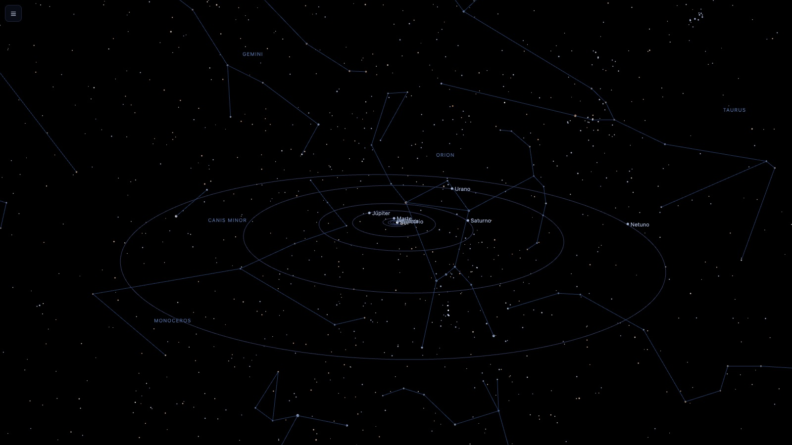
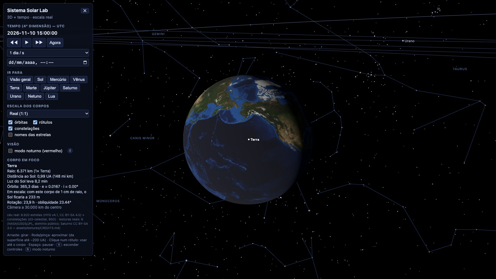
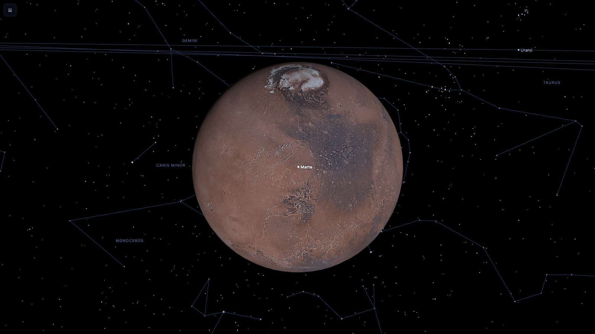
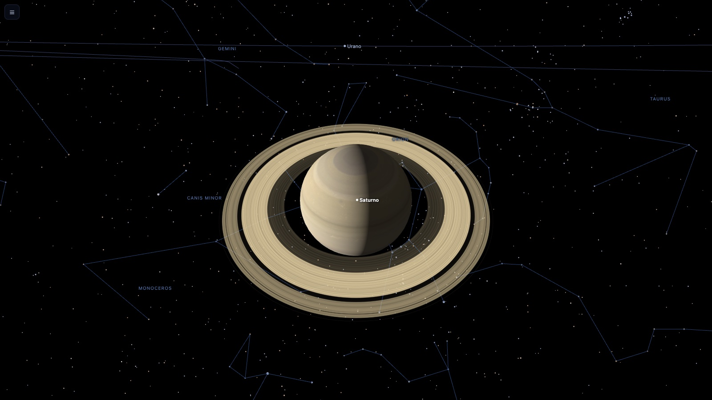
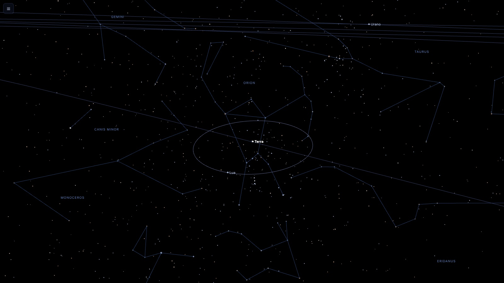
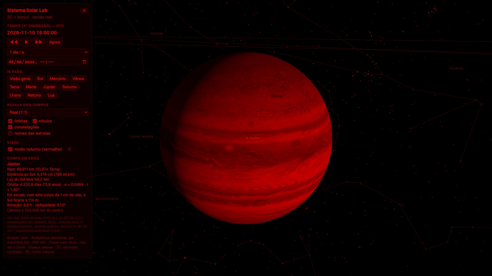

# Sistema Solar Lab

Laboratório open source do sistema solar: navegue em **3D e no tempo**, em **escala real**, com o céu de verdade ao fundo. Sol, 8 planetas e a Lua com órbitas calculadas, 8 920 estrelas e as 88 constelações reais, e texturas de missões da NASA. Roda no navegador, sem build.

> 🚧 Protótipo. As órbitas são precisas para visualização (1800–2050); fora disso são extrapolação. Veja as [limitações](#limitações) e as [decisões](docs/decisoes/).

**Versão atual: [v0.1.0 — Primeira Luz](https://github.com/adventurelabsbrasil/sistema-solar-lab/releases/tag/v0.1.0)** · [CHANGELOG](CHANGELOG.md)

## Capturas

| | |
|---|---|
| <br>**Visão geral:** as 8 órbitas em 3D, com Órion e as outras constelações reais ao fundo | <br>**Terra** em escala real (textura Blue Marble) e o painel de controles, com o tempo em UTC |
| <br>**Marte** (mosaico do Viking) com os controles escondidos | <br>**Saturno**, com anéis nos limites reais e a divisão de Cassini |
| <br>**Terra e Lua** na proporção real de distância (384 mil km), diante de Órion | <br>**Modo noturno:** Júpiter (mapa da Cassini) em vermelho, para não ofuscar no escuro |

<sub>Capturas geradas com Chrome headless e renderização por software, em 10/11/2026 15:00 UTC.</sub>

## Ver

Precisa de Node 20+ (`npm install` traz só o [three.js](https://threejs.org/)) e de `python3` para o servidor local.

```bash
npm install
npm start          # http://localhost:8000
npm test           # mecânica orbital, céu e carregador de texturas (node --test)
```

Arraste para girar, use a roda (ou pinça) para aproximar, de ~13 km acima da superfície da Terra até 200 UA. Clique num rótulo, ou num botão de "Ir para", para voar até o corpo.

| Tecla | O que faz |
|---|---|
| `Espaço` | pausa / continua o tempo |
| `H` | esconde / mostra os controles (botão ☰ no canto quando escondidos) |
| `N` | modo noturno (vermelho) |

## As 4 dimensões

- **3 espaciais:** câmera orbital com origem flutuante e depth buffer logarítmico, sem tremedeira nem clipping de 10 km a bilhões de km.
- **Tempo:** ◀◀ retrocede, ▶▶ avança, ⏸ pausa; de 1 s/s (tempo real) a 100 anos/s; campo de data para saltar a qualquer instante dos anos 0001–9999 (UTC).

## Proporções reais

1 unidade de cena = 1 milhão de km. Raios e distâncias são os reais: a Terra é um ponto a 150 milhões de km do Sol e só vira esfera quando você chega perto. O painel mostra, por corpo, "se este corpo tivesse 1 cm de raio, o Sol estaria a X m". Há uma opção de ampliar os planetas (10×/30×, só tamanhos) para a visão geral.

## Corpos

Sol, 8 planetas (inclinação e nó orbital, obliquidade do eixo, rotação, anéis de Saturno) e a Lua (com precessão do nó e do perigeu). Os elementos dos planetas são conferidos por teste contra a [Tabela 1 da JPL](https://ssd.jpl.nasa.gov/planets/approx_pos.html). Os da Lua, contra Simon et al. (1994) e a ficha da NASA, e a posição dela contra o [JPL Horizons](https://ssd.jpl.nasa.gov/horizons/) nos anos 1000, 2000 e 3000.

## Céu real

8 920 estrelas do catálogo HYG (até magnitude 6,5, o limite do olho nu), com cor pela temperatura e brilho pela magnitude, e as 88 constelações (linhas e nomes). Para apontar a câmera: `?look=84,2` (Órion) ou `?look=187,-60` (Cruzeiro do Sul), em RA/Dec J2000.

## Texturas reais

Mercúrio (MESSENGER), Terra (Blue Marble), Lua (Clementine), Marte (Viking), Júpiter (Cassini) e Saturno (mosaico CC BY-SA). Sol, Vênus, Urano e Netuno seguem procedurais, porque não há mapa de superfície redistribuível equivalente. Detalhes, fontes e como trocar: [`assets/textures/README.md`](assets/textures/README.md).

## Modo noturno (vermelho)

Converte toda a imagem em tons de vermelho. A luz vermelha estimula pouco os bastonetes do olho, então preserva a adaptação ao escuro e ofusca menos, a mesma ideia das lanternas vermelhas usadas em astronomia. Não é infravermelho de verdade e não substitui baixar o brilho da tela. A nota (i) no painel explica isso na própria tela. Também vale `?noturno=1`.

## Link direto

`?foco=saturno&dist=0.45&data=2030-06-01T12:00&rate=0&look=84,2&noturno=1&controles=0`

`foco` (corpo ou `geral`), `dist` (milhões de km da câmera), `data` (UTC), `rate=0` (pausado), `look` (RA,Dec), `noturno`, `controles=0` (esconde o painel).

## Gerar os dados de novo

Os arquivos de `assets/` são gerados por scripts, para o pipeline ser reprodutível:

```bash
python3 -I scripts/build-sky.py          # estrelas e constelações (HYG + d3-celestial)
python3 -I scripts/fetch-textures.py     # texturas (Wikimedia Commons; usa `sips` no macOS)
```

## O que já está decidido

| | |
|---|---|
| **Stack** | JavaScript puro + three.js via import map, sem bundler |
| **Escala** | real (1 unidade = 1 milhão de km); ampliação só visual e só de tamanhos |
| **Órbitas** | elementos keplerianos J2000 (JPL) + equação de Kepler, módulo puro testável |
| **Céu** | HYG v4.1 até mag 6,5 + constelações do d3-celestial |
| **Texturas** | mapas de domínio público quando existem; procedural quando não |
| **Precisão** | visualização (1800–2050), sem perturbações planeta–planeta |

Detalhes e justificativas em [`docs/decisoes/`](docs/decisoes/).

## Estrutura

```
index.html              UI e import map
src/orbits.js           mecânica orbital 3D (pura)
src/sky-math.js         RA/Dec → eclíptica, cor e brilho estelar (pura)
src/texture-loader.js   carga de texturas com falha isolada por corpo (pura)
src/data/bodies.js      elementos orbitais e dados físicos
src/sky.js, textures.js céu real, texturas e anéis
src/main.js             cena, origem flutuante, voo, tempo, UI
scripts/                geração de dados e texturas
assets/                 céu, texturas e créditos
test/                   testes (node --test) e fixture da JPL
docs/decisoes/          decisões de projeto
```

## Limitações

- Elementos médios de J2000: fora de ~1800–2050 as posições são extrapolação. Sem perturbações planeta–planeta nem as taxas seculares (exceto a da longitude média).
- A Lua é uma elipse kepleriana com nó e perigeu precessionando, sem evecção, variação e demais perturbações solares: erro médio de ~0,9° na posição e ~3 000 km na distância em relação ao JPL Horizons.
- A direção dos polos de rotação é aproximada (a obliquidade é correta).
- Sem Via Láctea, planetas-anões, luas dos gigantes nem cometas; estrelas sem paralaxe e só até mag 6,5.
- Lua em baixa resolução (1080×540).

## Contribuir

Veja [CONTRIBUTING.md](CONTRIBUTING.md). Commits usam DCO (`git commit -s`).

## Licenças

- Código: [MIT](LICENSE)
- Estrelas: [CC BY-SA 4.0](assets/sky/LICENSE) (HYG); constelações: BSD-3 (d3-celestial)
- Texturas: domínio público (NASA/JPL/USGS) e CC BY-SA 3.0 (Saturno), ver [CREDITS](assets/textures/CREDITS.md)

Créditos completos em [ATTRIBUTION.md](ATTRIBUTION.md).
